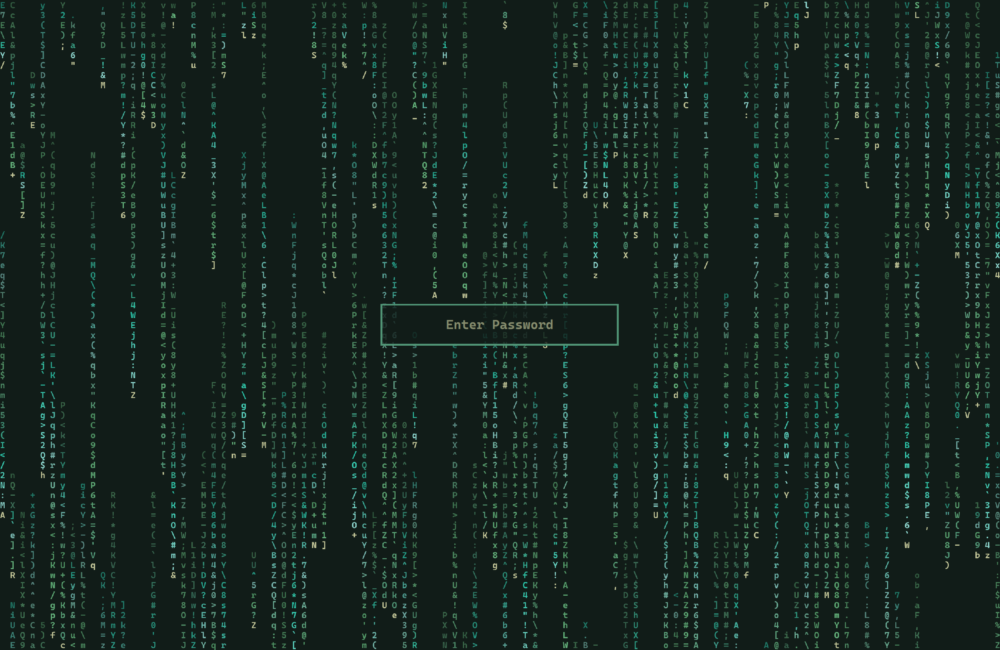
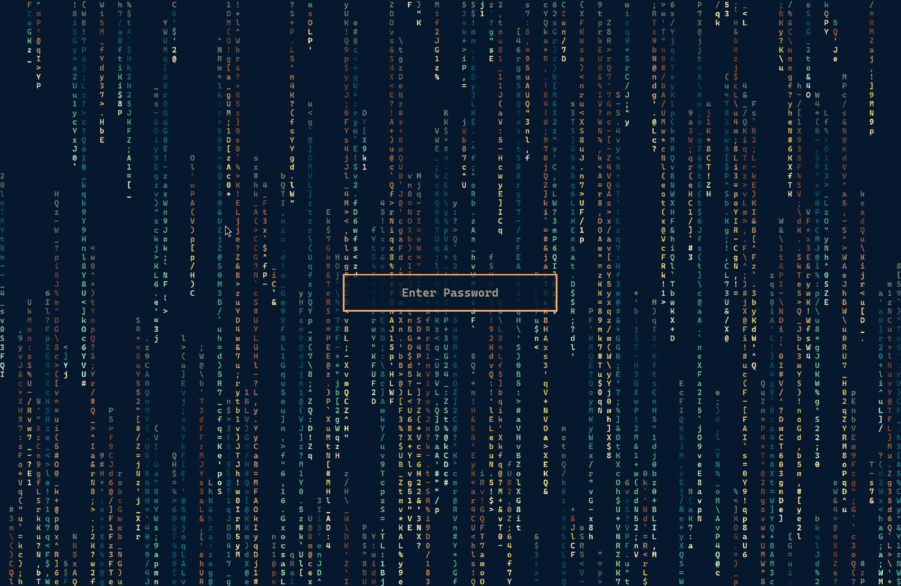

# Matrix Screens for Omarchy

Matrix digital rain as your desktop background, your screensaver and your lock screen, in your theme's colors. A bar icon switches each one on or off.


## What it does

- **Background.** The rain falls behind your windows on every monitor.
- **Screensaver.** The rain covers every monitor when the computer goes idle. It closes on a key press, a click or a mouse movement. The lock still follows at your lock timeout.
- **Lock screen.** The rain falls behind the password box.
- **Bar icon.** Click the matrix icon for a panel with a live preview of the rain in the current colors (click it to preview the screensaver full screen), and one switch each for the background, the screensaver and the lock screen. Below them, two collapsible sections (both closed until you open them): **Customize Text & Display** and **Modify Color Palette**. Right-click the icon to start the screensaver.
- **Same look everywhere.** All three draw the same rain inside the desktop shell, with the same font, character size, speed and colors.
- **Every theme works.** The plugin draws a rain tile for the active theme and adds it to the background switcher. If the rain is on when you switch themes, it selects the new theme's tile, so the rain stays on.
- **Hand-tuned colors for eight themes.** Tokyo Night, Hackerman, White, Vantablack, Retro-82, Catppuccin, Ethereal and Spectrum come with their own palettes. Any other theme uses its own colors: heads in the foreground color, tails in its accent, green and cyan, fading toward the background.
- **Your own colors.** A palette file in `~/.config/omarchy/matrix-screens/<theme>.toml` wins over everything else (see [Colors](#colors)).
- **Font included.** The rain uses the bundled Caskaydia Cove Nerd Font Mono, so it looks the same whatever fonts you have installed.
- **Light on power.** The background rain stops whenever nobody can see it: behind a fullscreen window, under the lock or the screensaver, or when another wallpaper is selected. All the rain slows down on battery.

## Screenshots

The rain full screen and behind the lock screen, in three themes:

| Tokyo Night | Osaka Jade | Retro-82 |
|---|---|---|
|  |  |  |
|  |  |  |

Tokyo Night and Retro-82 use the bundled palettes; Osaka Jade has none, so it uses the theme's own colors.

The bar icon and its panel:

| | |
|---|---|
|  | The matrix icon in the bar (underlined while its panel is open). |
|  | The panel: live preview (click it for the full-screen screensaver), and the Background, Screensaver and Lock Screen switches. |
|  | **Customize Text & Display**: typeface, size, tail fade, hue shift and speed. |
|  | The typeface dropdown, with a search box. |
|  | Unsaved changes turn the section's save, undo and reset icons red; the preview shows the draft. |
|  | **Modify Color Palette**: head and background, tail color groups, and the color picker. |
|  | Scrolled down: the preview stays pinned; the theme's colors as quick picks, and Manually Edit Color Configuration. |

## The lock screen

While the plugin is enabled, **it is your lock screen**. Omarchy lets a plugin take the place of its built-in lock (the same way `omarchy plugin clone omarchy.lock` does). Enabling Matrix Screens switches the built-in lock off, and disabling or removing the plugin switches it back on.

The lock code is Omarchy's own lock from Omarchy 4.0.3 (MIT), with the rain added. It uses the same PAM password and fingerprint flows. With the lock-screen switch off, it looks and works exactly like the built-in lock. Omarchy updates to its built-in lock don't reach this copy until the plugin is updated.

If you already use another lock plugin (a clone of `omarchy.lock`), disable it before enabling this one.

## Requirements

Everything comes with Omarchy:

- Omarchy 4 with its Quickshell desktop shell (`omarchy-shell`), on Hyprland
- `jq` and `hyprctl` for the command-line tool
- ImageMagick (`magick`) to draw the background-switcher tiles. If it's missing, the rain still runs, but no new tiles get drawn (`omarchy pkg add imagemagick`).

The plugin needs no other plugins. To run the tests, you also need `node`.

## Installation

```bash
omarchy plugin add https://github.com/WhiskeyTangoFussell/omarchy-matrix-screens --enable
```

This puts the matrix icon on the right of your bar and makes the plugin your lock screen. Use the icon's panel to switch on what you want. You can also pick the rain tile, `matrix-screens.png`, in the background switcher (`Super + Ctrl + Space`).

Out of the box, the background follows the background switcher, the lock-screen rain is on, and the screensaver is off.

Plugins run as unsandboxed code inside your desktop shell, so read the code before enabling one. This plugin runs nothing at install time and never asks for `sudo`.

## The three switches

| Switch | On | Off |
|---|---|---|
| Background | Selects the active theme's rain tile, so the rain shows. | Goes back to the wallpaper you had before, or to the theme's first one. |
| Screensaver | The rain starts when Omarchy would start its screensaver, and Omarchy's own screensaver stays out of the way. | Omarchy's screensaver (or whichever one you use) runs as usual. |
| Lock screen | Rain behind the password box. | Omarchy's usual blurred wallpaper. |

The screensaver also respects Omarchy's own screensaver switch (*Trigger > Toggle > Screensaver*). If you use another screensaver tool that takes over the idle launch, turn this screensaver off, or turn that tool's takeover off. If both start, the one whose window appears gets the screen.

## Colors

The plugin uses the first of these files that exists for the active theme. The whole file applies, and the rest are ignored:

| Priority | File | What it's for |
|---|---|---|
| 1 | `~/.config/omarchy/matrix-screens/<theme>.toml` | Your custom colors |
| 2 | `matrix-screens.toml` in the theme | A theme that ships its own rain palette |
| 3 | `omatrix.toml` in the theme | Themes made for the omatrix plugin |
| 4 | `palettes/<theme>.toml` in this plugin | The bundled palettes |
| — | none of these | The theme's own colors |

There are two ways to make your own colors for the current theme. Both save to `~/.config/omarchy/matrix-screens/<theme>.toml`, and the rain and the tile update as soon as you save:

- **Customize Text & Display** has a **Typeface** dropdown (the bundled Caskaydia Cove, Omarchy's own font, or any installed monospace font, with a search box), a **Size** slider (8–32 px; Omarchy's base size until you move it), and the **Tail fade**, **Hue shift** and **Speed** sliders (defaults 0.50, 6.0 and 12 steps per second). **Modify Color Palette** (also opened by `matrix-screens colors`) holds the colors. While either is open, the title and preview stay pinned at the top as you scroll, and the preview shows your unsaved changes. In Modify Color Palette, Click a swatch (the head, the background or a tail color), then pick its color in the hue and saturation picker, type a hex value, or click one of the theme's own colors. Each hue group is a chip: **+** adds a shade, *Add group* adds a hue, and right-clicking a tail swatch removes it, up to 12 tail colors in all. Typeface, size and speed apply to every theme. Saving writes the colors to this theme's file (keeping any hand-written settings already in it), and the text & display settings (typeface, size, fade, hue shift, speed) to the plugin's settings in `shell.json`, for every theme; the speed applies on battery too. Icons that would do nothing are faded. Scrolling with the mouse wheel or trackpad over a slider scrolls the panel instead of moving the slider. Unsaved changes are also dropped when the panel closes. Each section header has its own **save**, **undo** and **reset** icons on the right, which act on that section only; they turn bright red while the section has unsaved changes and are faded when they would do nothing. Text & display reset goes back to the plugin defaults; color palette reset deletes your custom color file.
- **Manually Edit Color Configuration**, at the bottom of Modify Color Palette (or `matrix-screens customize`), copies the palette in use into that file and opens it in your default editor.

Delete the file to go back to the theme's or the bundled colors.

A palette file sets colors. Colors are `#rrggbb` or any name from the theme's `colors.toml` (`accent`, `foreground`, `green`, `bright_cyan` and so on). Your own custom file can also set the tail fade and hue shift (and any other setting); theme and bundled palettes supply colors only, so the plugin defaults apply to everything else:

```toml
head_color = "#ffffff"   # the leading glyph of each stream
color = "green"          # tails, when tail_colors is empty

# Hue groups separated by "|", shades in a group by ",". Up to 12 colors in all.
# Each stream picks one group, and each glyph picks a random shade from it.
tail_colors = "#ff8fd8, #ff2fb9, #b8007f | #d59bff, #b14dff, #7400d6 | #8fd8ff, #1fb4ff, #0062d1"

tail_fade = 0.5          # custom file only: 0..1, how far each tail dims toward the background
tail_hue_shift = 6       # custom file only: how many tail colors each stream sweeps through
background_color = "background"
```

A color you leave out of a palette file falls back to plain cmatrix values (green tails, white heads), not to the theme defaults.

## Settings

The switches and every other setting live in the plugin's entry in `~/.config/omarchy/shell.json` (its bar entry). Either key style works. Values here also beat the palette file:

```json
{ "id": "io.github.whiskeytangofussell.matrixscreens", "screensaver": true, "update_delay": 6 }
```

| Key | Default | Notes |
|---|---|---|
| `screensaver` | `false` | the screensaver switch |
| `lock_screen` | `true` | the lock-screen switch |
| `background` | `"tile"` | `"tile"`: rain while a rain tile is the background (the background switch). `"always"`: under every background. `"off"`: never |
| `background_tile` | `true` | draw the active theme's rain tile into the background switcher |
| `keep_on_theme_switch` | `true` | reselect the rain tile after a theme switch if the rain was on |
| `screensaver_dismiss_on_mouse` | `true` | close the screensaver when the mouse moves, not just on a key press |
| `update_delay` | `8.333` | 0–30. The rain steps every `delay × 10` ms (8.333 ≈ 83 ms, 12 steps/s). Set from the Speed slider |
| `tail_fade` / `tail_hue_shift` | `0.5` / `6` | how far tails dim toward the background, and how many tail colors each stream drifts through. Set from Customize Text & Display (a hand-written value in your custom color file works per theme, but shell.json wins) |
| `battery_update_delay` | `8.333` | the step delay on battery with `on_battery = "slow"` |
| `on_battery` | `"slow"` | `"slow"`, `"pause"` or `"ignore"` |
| `bold` | `"all"` | `"none"`, `"partial"` or `"all"` |
| `charset` | `"ascii"` | `"ascii"`, `"katakana"` or `"console"` |
| `justify_columns` | `true` | spread the columns from screen edge to screen edge |
| `font_family` / `font_size` | bundled font / shell size | Set from Customize. `font_family = ""` uses Omarchy's monospace font; `font_size = 0` its base size |
| `asynchronous`, `changes`, `lambda`, `oldstyle`, `rainbow` | `false` | the matching cmatrix flags (`-a`, `-k`, `-m`, `-o`, `-r`) |
| `opacity`, `backdrop_opacity` | `1.0`, `0.0` | rain opacity, and a black scrim behind it |
| `start` | `"wake"` | `"wake"` fills an empty screen, like launching cmatrix. `"full"` starts mid-run |
| `pause_when_covered`, `pause_when_locked` | `true` | stop the background behind fullscreen windows and the lock screen |

## Command line

```bash
B=~/.config/omarchy/plugins/io.github.whiskeytangofussell.matrixscreens/bin/matrix-screens
$B status                                  # what's on, which palette, font and speed
$B background on|off|toggle
$B screensaver on|off|toggle
$B lock on|off|toggle
$B screensaver launch                      # start it now (stop closes it)
$B colors                                  # open the panel at Modify Color Palette
$B customize [theme]                       # your own copy of a theme's colors, to edit by hand
$B background-mode tile|always|off
```

Shell IPC: `omarchy-shell matrixscreens status | colors | reloadPalette | screensaver | stopScreensaver | set <background|screensaver|lock> <on|off> | pause | resume | wake`. The lock keeps Omarchy's `omarchy-shell lock lock | isLocked | status | preview | hidePreview`.

## How it works

- **Renderer.** `cmatrix.js` is a line-for-line port of cmatrix's main loop. `MatrixScreen.qml` keeps one pixel per terminal cell in a state image and redraws only the cells that changed. A fragment shader (`shaders/matrix.frag`) turns that image into glyphs on the GPU. Both come from [omatrix](https://github.com/0x1ocean/omarchy-omatrix), plus tail color groups, tail fade, hue shift, justified columns and fractional speeds. `RainView.qml` binds it to the current settings. The background, the screensaver and the lock all use it.
- **Service.** `Service.qml` is the lock screen (Omarchy's lock with the rain added). `Rain.qml` inside it runs everything else.
- **Background.** The rain sits on the Wayland bottom layer (above the wallpaper, below windows). `Rain.qml` watches `~/.local/state/omarchy/current` and turns the rain on while the background is a rain tile. Both `matrix-screens.png` and an older `omatrix.png` count.
- **Tiles.** `bin/matrix-screens tile` draws a still frame with the bundled font into `~/.config/omarchy/backgrounds/<theme>/matrix-screens.png`. It redraws the tile only when the colors change. A theme that already has an `omatrix.png` tile keeps it.
- **Screensaver.** The rain sits on the overlay layer of every monitor. When Omarchy's idle service starts the screensaver, the plugin shows the rain and starts a small marker process. Omarchy's launcher finds the marker with its "already running" check and steps aside. Activity ends Omarchy's idle cycle, which closes the rain. The lock timer keeps running while the rain is up.
- **Editor.** `ColorEditor.qml` holds the panel's two sections (Customize Text & Display, Modify Color Palette), with its logic (color conversion, the draft, writing the file) in `colors.js`.
- **Bar icon.** `Panel.qml` shows the three switches. It saves them through the shell, in the plugin's `shell.json` entry.

### Where things are stored

| What | Where |
|---|---|
| The switches and settings | the plugin's entry in `~/.config/omarchy/shell.json` |
| Your colors | `~/.config/omarchy/matrix-screens/<theme>.toml` |
| Generated tiles | `~/.config/omarchy/backgrounds/<theme>/matrix-screens.png` |
| Tile bookkeeping | `~/.local/state/matrix-screens/tiles/` |

## Removal

```bash
omarchy plugin remove io.github.whiskeytangofussell.matrixscreens   # Omarchy's own lock comes back
rm -f ~/.config/omarchy/backgrounds/*/matrix-screens.png
rm -rf ~/.local/state/matrix-screens
rm -rf ~/.config/omarchy/matrix-screens   # only if you don't want to keep your colors
```

If a rain tile was your background, pick another one in the background switcher.

When you disable the plugin, Omarchy puts `omarchy.lock` back in the bar layout where the icon was. That entry has no widget, so nothing shows, but you can delete it from `bar.layout` in `shell.json`.

## Development

```bash
node --test tests/              # engine and settings tests
quickshell -p Preview.qml       # renderer in a window, with per-tick timings
./build-shaders.sh              # after editing shaders/matrix.frag (needs qt6-shadertools)
omarchy plugin validate .
```

Copy the checkout into `~/.config/omarchy/plugins/io.github.whiskeytangofussell.matrixscreens/` (a symlinked folder isn't watched), then run `omarchy-restart-shell`. Test the lock with `omarchy-shell lock preview` and `omarchy-shell lock hidePreview`.

## Licence

GPL-3.0-or-later (see [LICENSE](LICENSE)).

Parts come from other projects:

- The renderer is derived from [omatrix](https://github.com/0x1ocean/omarchy-omatrix) by 0x1ocean (GPL-3.0-or-later).
- `cmatrix.js` is derived from [cmatrix](https://github.com/abishekvashok/cmatrix) by Chris Allegretta, Abishek V Ashok and contributors (GPL-3.0).
- `Service.qml` and `LockView.qml` are based on Omarchy's lock plugin (© David Heinemeier Hansson and contributors, MIT).
- The bundled fonts in `fonts/` are Caskaydia Cove Nerd Font Mono from [Nerd Fonts](https://github.com/ryanoasis/nerd-fonts) 3.5.1 (as packaged in Arch's `ttf-cascadia-code-nerd`). They're patched from Microsoft's [Cascadia Code](https://github.com/microsoft/cascadia-code) and licensed under the SIL Open Font License 1.1 ([fonts/OFL.txt](fonts/OFL.txt)).
