# Matrix Screens for Omarchy

Matrix digital rain as your desktop background, screensaver and lock screen, in your theme's colors. A bar icon switches each one on or off.

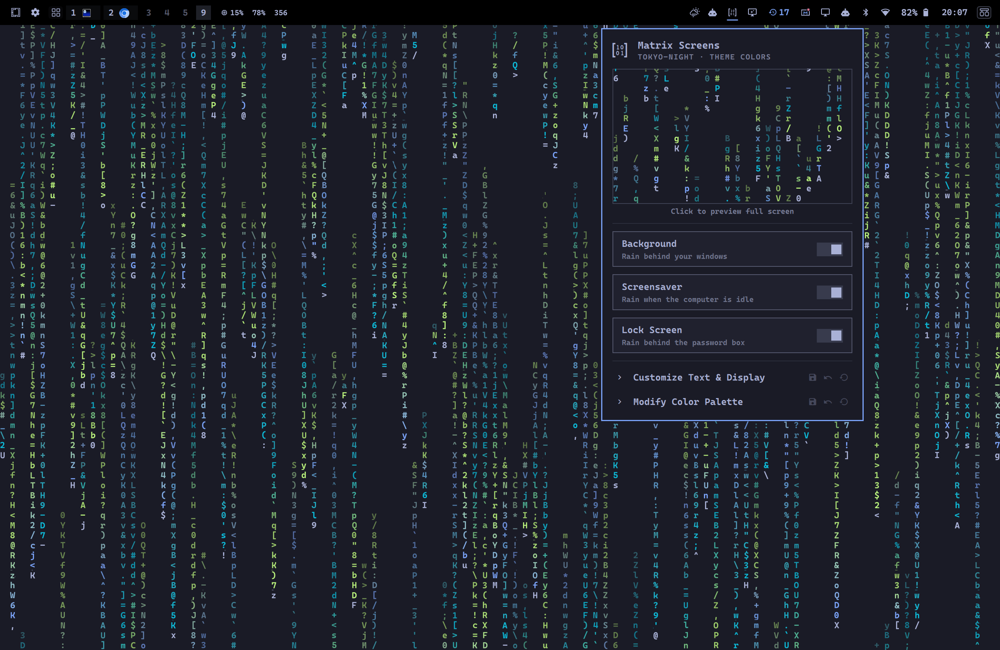

## Features

- **Background, screensaver and lock screen**, each switched on or off on its own. All three draw the same rain with the same font, size, speed and colors.
- **Every theme works.** Eight themes have hand-tuned palettes (Tokyo Night, Hackerman, White, Vantablack, Retro-82, Catppuccin, Ethereal, Spectrum); any other theme uses its own colors.
- **Customize from the bar:** typeface, size, tail fade, hue shift and speed for every theme, and a color editor for each theme, with a live preview.
- **Bundled font:** Caskaydia Cove Nerd Font Mono, so the rain looks the same whatever fonts you have installed.
- **Light on power:** the background rain stops behind fullscreen windows, under the lock and the screensaver, and while another wallpaper is selected.

## Screenshots

| Tokyo Night | Osaka Jade | Retro-82 |
|---|---|---|
| 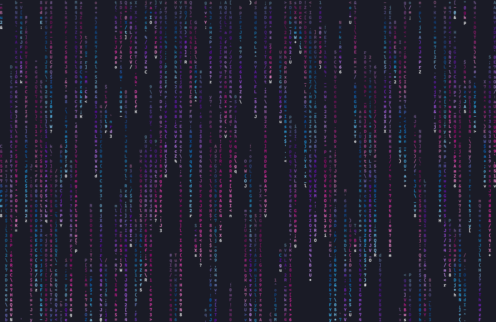 | 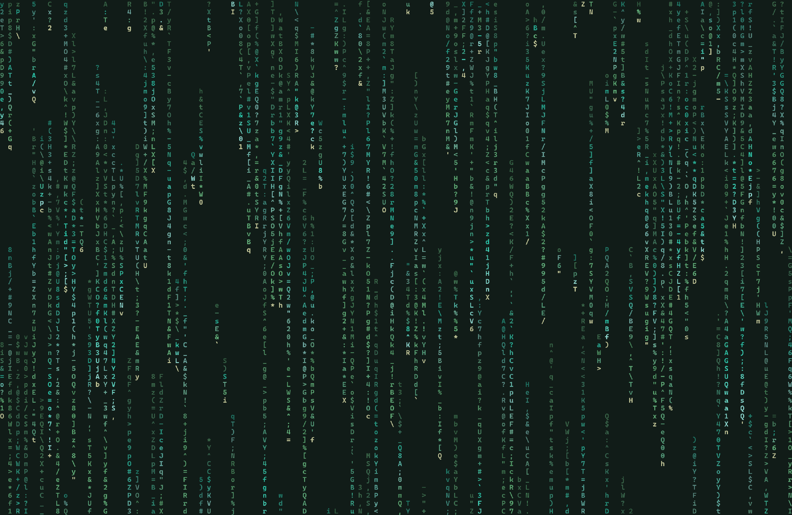 | 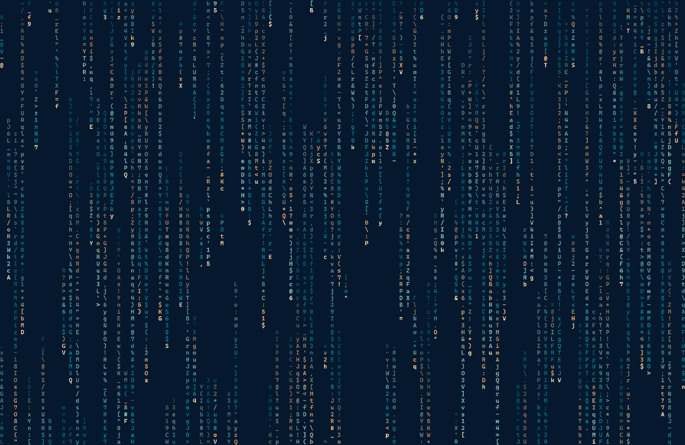 |

Osaka Jade has no bundled palette, so it uses the theme's own colors.

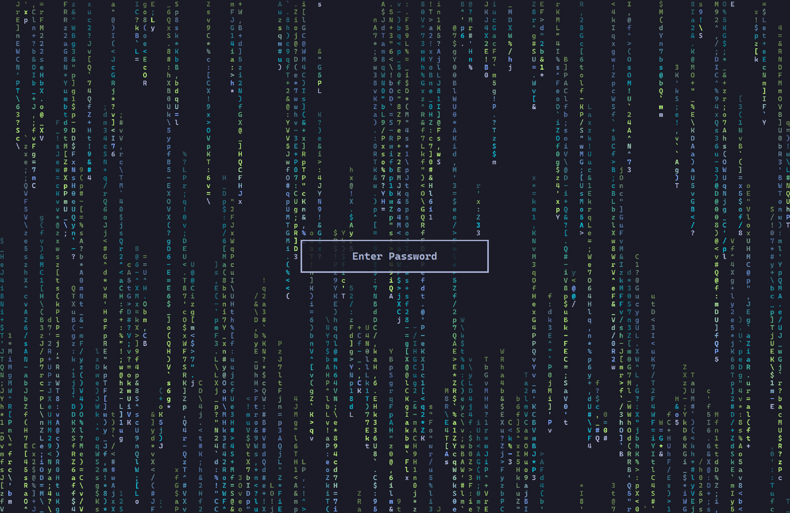

| | |
|---|---|
|  | The bar icon. Click it for the panel; right-click to start the screensaver. |
| 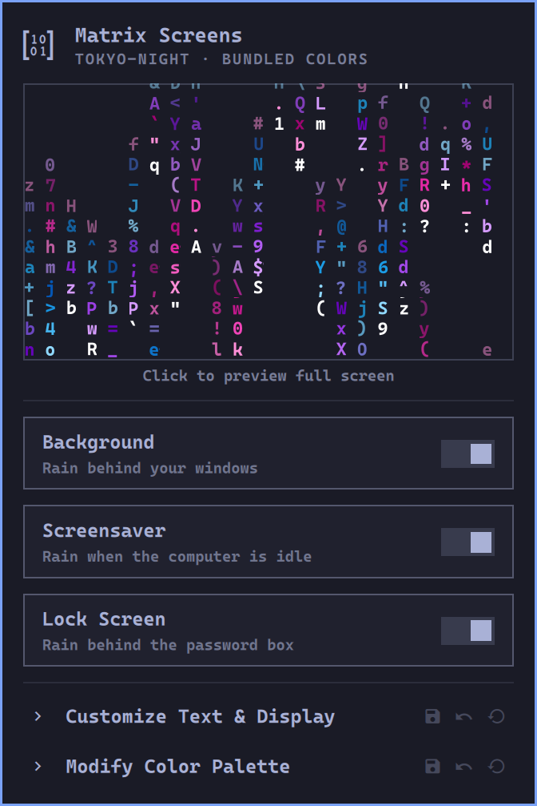 | The panel: a live preview (click it for the full-screen screensaver) and the three switches. |
| 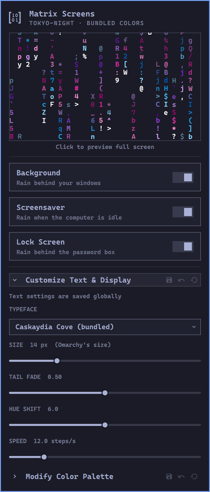 | **Customize Text & Display**: typeface, size, tail fade, hue shift and speed. |
| 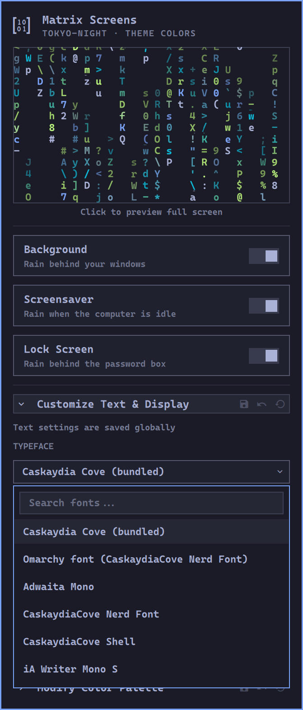 | The typeface dropdown, with a search box. |
| 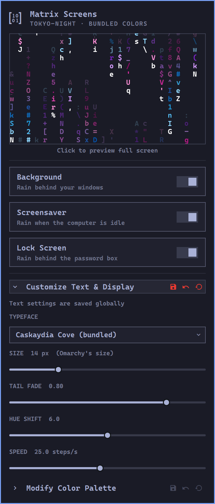 | Unsaved changes turn the section's save, undo and reset icons red; the preview shows the draft. |
| 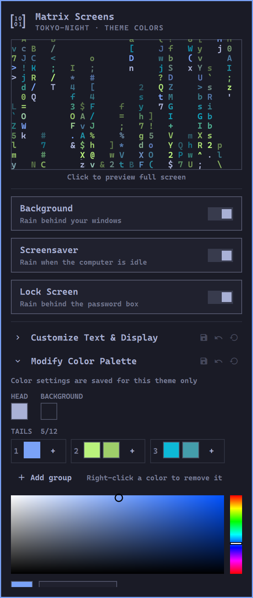 | **Modify Color Palette**: head, background and tail colors, with a color picker. |
| 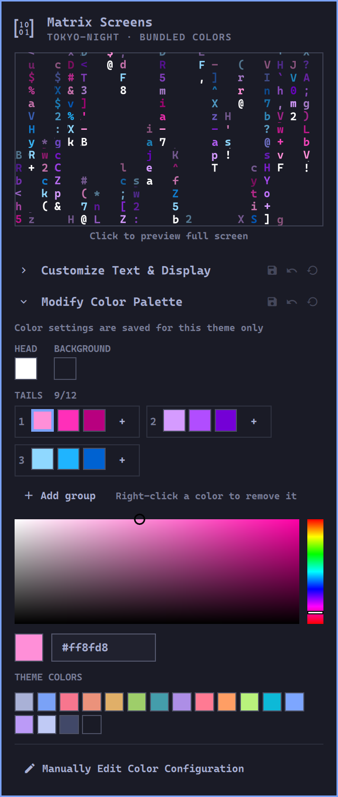 | The theme's colors as quick picks, and *Manually Edit Color Configuration*. |

## Installation

```bash
omarchy plugin add https://github.com/WhiskeyTangoFussell/omarchy-matrix-screens --enable
```

This adds the matrix icon to the right of your bar. Out of the box the lock-screen rain is on, the screensaver is off, and the background rain shows while its tile is selected in the background switcher (`Super + Ctrl + Space`).

**Requirements:** Omarchy 4 (Quickshell shell, Hyprland), with `jq`, `hyprctl` and `fontconfig`, all part of Omarchy. ImageMagick draws the background-switcher tiles; without it the rain still runs (`omarchy pkg add imagemagick`). No other plugins are needed.

**The lock screen:** while the plugin is enabled, it *is* your lock screen. It takes the place of Omarchy's built-in lock the same way `omarchy plugin clone omarchy.lock` does, and disabling or removing the plugin brings the built-in lock back. The lock code is Omarchy 4.0.3's own (same PAM password and fingerprint flows) with the rain added; with the lock-screen switch off it looks like the built-in lock. Updates Omarchy makes to its lock reach this copy only when the plugin is updated. If you use another lock plugin, disable it first.

Plugins run as unsandboxed code in your desktop shell, so read the code before enabling one. This one runs nothing at install time and never asks for `sudo`.

## Using it

### The switches

| Switch | On | Off |
|---|---|---|
| Background | Selects the theme's rain tile in the background switcher. | Goes back to your previous wallpaper (or the theme's first). |
| Screensaver | The rain starts when Omarchy would start its screensaver, which then stays out of the way. | Omarchy's screensaver runs as usual. |
| Lock Screen | Rain behind the password box. | Omarchy's blurred wallpaper. |

Each theme gets its own rain tile, drawn by the plugin. If the rain is on when you switch themes, the new theme's tile is selected, so it stays on. The screensaver closes on a key press, a click or a mouse movement, and respects Omarchy's own screensaver toggle; the lock still follows at your lock timeout.

### Customizing

The panel has two collapsible sections. Each header has **save**, **undo** and **reset** icons that act on that section only; they turn red while it has unsaved changes. Unsaved changes are dropped when the panel closes.

- **Customize Text & Display**: typeface, size (8–32 px), tail fade, hue shift and speed. Saved in the plugin's settings and used for **every theme**. Reset returns to the defaults: Caskaydia Cove at Omarchy's size, fade 0.50, hue shift 6, 12 steps per second.
- **Modify Color Palette**: click a swatch (head, background or a tail color), then pick a color, type a hex value or click one of the theme's colors. Tail colors come in hue groups (each stream uses one group): **+** adds a shade, *Add group* adds a hue, right-click removes a color, up to 12 in all. Saved for **this theme only**, in `~/.config/omarchy/matrix-screens/<theme>.toml`. Reset deletes that file. *Manually Edit Color Configuration* opens it in your editor.

### Where colors come from

For the active theme, the first of these that exists is used:

1. `~/.config/omarchy/matrix-screens/<theme>.toml`: your colors
2. `matrix-screens.toml` (or an omatrix-style `omatrix.toml`) shipped with the theme
3. `palettes/<theme>.toml` in this plugin: the bundled palettes
4. Otherwise, the theme's own colors: heads in its foreground color, tails in its accent, green and cyan

A palette file holds colors only. Colors are `#rrggbb` or any name from the theme's `colors.toml` (`accent`, `foreground`, `bright_cyan`, ...):

```toml
head_color = "#ffffff"
# Hue groups separated by "|", shades by ",": up to 12 colors.
tail_colors = "#ff8fd8, #ff2fb9, #b8007f | #d59bff, #b14dff, #7400d6 | #8fd8ff, #1fb4ff, #0062d1"
background_color = "background"
```

## Settings

Everything is stored in the plugin's entry in `~/.config/omarchy/shell.json`; the panel writes most of it. You can also edit it by hand (either key style works):

| Key | Default | |
|---|---|---|
| `screensaver`, `lock_screen` | `false`, `true` | the switches |
| `background` | `"tile"` | `"tile"`: while a rain tile is selected; `"always"`; `"off"` |
| `font_family`, `font_size` | Caskaydia Cove, `0` | `""` = Omarchy's font; `0` = Omarchy's size |
| `tail_fade`, `tail_hue_shift` | `0.5`, `6` | how far tails dim; how many tail colors each stream drifts through |
| `update_delay`, `battery_update_delay` | `8.333` | ms per step ÷ 10 (8.333 ≈ 12 steps per second); the panel sets both |
| `on_battery` | `"slow"` | `"slow"` uses `battery_update_delay` if it's slower, `"pause"` stops, `"ignore"` |
| `bold`, `charset` | `"all"`, `"ascii"` | `"none"`/`"partial"`/`"all"`; `"ascii"`/`"katakana"`/`"console"` |
| `justify_columns`, `start` | `true`, `"wake"` | columns edge to edge; `"wake"` fills an empty screen, `"full"` starts mid-run |
| `background_tile`, `keep_on_theme_switch` | `true` | draw rain tiles; reselect the tile after a theme switch |
| `screensaver_dismiss_on_mouse` | `true` | close the screensaver on mouse movement |
| `opacity`, `backdrop_opacity` | `1.0`, `0.0` | rain opacity; a black scrim behind it |
| `pause_when_covered`, `pause_when_locked` | `true` | stop the background behind fullscreen windows and the lock |
| `asynchronous`, `changes`, `lambda`, `oldstyle`, `rainbow` | `false` | cmatrix's `-a`, `-k`, `-m`, `-o`, `-r` |

## Command line

```bash
B=~/.config/omarchy/plugins/io.github.whiskeytangofussell.matrixscreens/bin/matrix-screens
$B status
$B background|screensaver|lock on|off|toggle
$B screensaver launch|stop
$B colors              # open the panel at Modify Color Palette
$B customize [theme]   # copy the theme's colors to your file, for hand editing
```

The shell IPC target is `matrixscreens` (`omarchy-shell matrixscreens status`); the lock keeps Omarchy's `omarchy-shell lock ...` commands.

## Removal

```bash
omarchy plugin remove io.github.whiskeytangofussell.matrixscreens   # Omarchy's lock comes back
rm -f ~/.config/omarchy/backgrounds/*/matrix-screens.png
rm -rf ~/.local/state/matrix-screens ~/.config/omarchy/matrix-screens
```

If a rain tile was your background, pick another one. Disabling the plugin leaves an empty `omarchy.lock` entry in `bar.layout` in `shell.json`; it shows nothing and can be deleted.

## How it works

`cmatrix.js` is a line-for-line port of cmatrix's main loop. `MatrixScreen.qml` keeps one pixel per character cell in a small texture and a fragment shader draws the glyphs on the GPU; `RainView.qml` binds it to the settings. `Service.qml` is the lock screen and hosts `Rain.qml`, which runs the background (bottom layer), the screensaver (overlay layer), the tiles and the IPC. `Panel.qml` is the bar icon, and `ColorEditor.qml` (with `colors.js`) is the Customize sections. `bin/matrix-screens` is the command line and draws the tiles.

For the screensaver, the plugin starts the rain when Omarchy's idle service begins the screensaver, and runs a marker process that Omarchy's launcher sees as "already running". Activity ends the idle cycle and closes the rain.

## Development

```bash
node --test tests/     # engine, settings and color tests
./build-shaders.sh     # after editing shaders/matrix.frag (needs qt6-shadertools)
omarchy plugin validate .
```

Copy the checkout into `~/.config/omarchy/plugins/io.github.whiskeytangofussell.matrixscreens/` (a symlink isn't watched) and run `omarchy-restart-shell`. Preview the lock with `omarchy-shell lock preview`.

## License

GPL-3.0-or-later (see [LICENSE](LICENSE)), as required by the code it's built on:

- The engine (`cmatrix.js`) is a port of [cmatrix](https://github.com/abishekvashok/cmatrix) (GPL-3.0), and the renderer, shader and settings come from [omatrix](https://github.com/0x1ocean/omarchy-omatrix) by 0x1ocean (GPL-3.0).
- `Service.qml` and `LockView.qml` are based on Omarchy's lock plugin (© David Heinemeier Hansson and contributors, MIT).
- The fonts in `fonts/` are Caskaydia Cove Nerd Font Mono from [Nerd Fonts](https://github.com/ryanoasis/nerd-fonts) 3.5.1, patched from Microsoft's [Cascadia Code](https://github.com/microsoft/cascadia-code), under the SIL Open Font License 1.1 ([fonts/OFL.txt](fonts/OFL.txt)).
